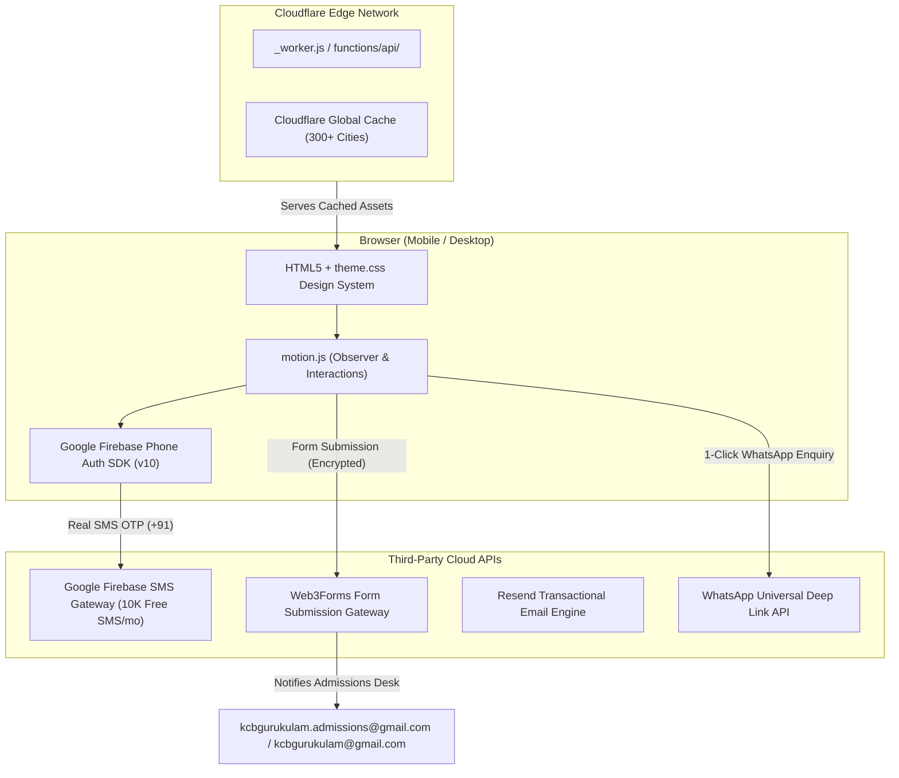

# KCB Gurukulam — Master Project Documentation & Developer Handbook

> **Institution:** KCB Gurukulam  
> **Location:** Beside KCB Gardens, New Housing Board Road, Adilabad - 504001, Telangana  
> **Official Website:** [https://kcbgurukulam.in](https://kcbgurukulam.in)  
> **Official Helpline:** +91 8331949000 / +91 8332949000 (WhatsApp)  
> **Admissions Email:** kcbgurukulam.admissions@gmail.com  
> **General & Careers Email:** kcbgurukulam@gmail.com  
> **Primary Technology Stack:** Semantic HTML5, Vanilla CSS3 Design System, Vanilla JS, Google Firebase Phone Auth, Web3Forms, Resend API, Cloudflare Pages Edge Serverless.

---

## 1. Executive Summary & Project Purpose

This repository houses the complete, production-ready official web portal for **KCB Gurukulam**, premier English-medium educational institution in Adilabad.

The platform is engineered to deliver:
1. **Ultra-Fast Performance:** 100% static, zero-bloat codebase (0 heavy frameworks) achieving near-instant first contentful paint (< 0.8s) across Indian 4G/5G and mobile devices.
2. **Verified Lead Generation:** Fraud-resistant admission enquiry system featuring **Google Firebase Real SMS OTP** (10,000 free SMS/month) + 1-Click WhatsApp Enquiry.
3. **Multi-Layer Cyber Defense:** Hardened against scraping, clickjacking, MIME-sniffing, XSS, spambots, and directory snooping.
4. **Cloudflare Pages Serverless Ready:** Zero hosting costs, zero database upkeep, zero server maintenance.

---

## 2. Architecture & Technology Stack



| Component | Technology | Rationale |
| :--- | :--- | :--- |
| **Markup** | HTML5 (Semantic) | Maximum SEO score, accessibility, clean DOM tree. |
| **Styling** | Custom CSS3 (`theme.css`) | 0 heavy frameworks (No Bootstrap/Tailwind dependencies), fluid responsive variables, custom typography (Anton + Poppins). |
| **Interactivity** | Vanilla JS (`motion.js`) | Lightweight observer engine for reveal animations, navbar blur, modal popups, and OTP flows. |
| **SMS Verification** | Google Firebase Phone Auth | 100% Free (10,000 real SMS/month), bypasses costly Indian TRAI DLT registration. |
| **Email Verification** | Resend API + Cloudflare Edge | Fallback email verification with cryptographic stateless HMAC tokens. |
| **Lead Routing** | Web3Forms REST API | Instant delivery of leads to `kcbgurukulam.admissions@gmail.com` and `kcbgurukulam@gmail.com` with anti-bot honeypot. |
| **Hosting** | Cloudflare Pages / Apache cPanel | Infinite free bandwidth, DDoS protection, edge caching across India (Hyd/Mum/Del/Blr). |

---

## 3. Directory & File Manifest

```
school/
├── index.html                      # Homepage: Hero, Wings, Features, Real SMS OTP Admission Form
├── about.html                      # Institutional Vision, Mission, Core Educational Pillars
├── management.html                 # Founder, Managing Director & Principal Leadership Profiles
├── preprimary.html                 # Nursery, LKG, UKG Montessori & Activity Wings
├── primary.html                    # Classes I - V Experiential Pedagogy & Curriculum
├── upperprimary.html               # Classes VI+ STEM, Language Labs & Analytical Curriculum
├── life.html                       # Daily Student Routine, Assemblies, House System & Clubs
├── arts.html                       # Classical Dance, Music, Theatre, Drawing & Annual Day
├── sports.html                     # Karate Training, Football, Athletics & Sports Infrastructure
├── gallery.html                    # Categorized Photo Gallery with Responsive Lightbox
├── transport.html                  # GPS-monitored Bus Routes & Seat Reservation Request Form
├── contact.html                    # Campus Location, Timings, Direct Calling & Careers Form
├── thankyou.html                   # Submission Confirmation Page with Next Steps & Helpline
│
├── theme.css                       # Master Design System, Color Tokens, Mobile Grids & Utilities
├── motion.js                       # Observer Animations, Header Blur, Form Sanitizer, Firebase SMS Engine
│
├── _worker.js                      # Cloudflare Pages Edge Worker (Stateless OTP & Static Asset Routing)
├── functions/                      # Cloudflare Pages Native Functions (Alternative Structure)
│   └── api/
│       ├── send-otp.js             # Serverless Send OTP Edge Endpoint
│       └── verify-otp.js           # Serverless Verify OTP Edge Endpoint
│
├── api/                            # PHP Backend (For cPanel / Hostinger / Apache Hosting)
│   ├── config.php                  # Secret Resend API Configuration
│   ├── send-otp.php                # PHP Send OTP Handler
│   └── verify-otp.php              # PHP Verify OTP Handler
│
├── local_test_server.py            # Local Python Testing Server (Zero Setup on Mac/Windows)
│
├── PNG LOGO copy.jpg               # Official School Logo
├── kcbg.png                        # School Favicon & Browser Tab Icon
│
├── robots.txt                      # Search Engine Crawl Rules
├── sitemap.xml                     # Complete 13-Page Canonical Sitemap for Google Indexing
├── .htaccess                       # Apache Security Hardening & MIME Type Protection
└── _headers                        # Cloudflare HTTP Security Headers (OWASP Standard)
```

---

## 4. Key Workflows & Features

### 4.1 Admission Enquiry Workflow (100% Real SMS OTP via Google Firebase)

1. **Visitor Entry:** Parent fills in Student Name, Parent Name, and 10-Digit Mobile Number (Email is optional).
2. **"Send SMS OTP" Click:**
   - Frontend validates the 10-digit Indian Mobile (`/^[6-9]\d{9}$/`).
   - Google Firebase Phone Auth immediately triggers real SMS delivery to `+91 [mobile]`.
   - Invisible Google reCAPTCHA runs silently in the background (`#otpRecaptcha`).
   - Status updates: *"✓ 6-Digit SMS OTP sent to +91 [mobile]! Please enter the code received on your phone."*
   - Cooldown timer (30s) starts for the "Resend SMS OTP" option.
3. **SMS Verification:**
   - Parent enters the 6-digit code received via SMS on their phone.
   - Code checks against Firebase Phone confirmation (`confirmationResult.confirm(code)`).
   - On success: Mobile number locks (`readonly`), green badge shows `✓ Verified (SMS)`, and the Submit button unlocks!
4. **Submission:**
   - Form posts to Web3Forms via AJAX with anti-bot honeypot protection.
   - Instant lead notification is delivered to school desk (`kcbgurukulam.admissions@gmail.com` / `kcbgurukulam@gmail.com`).
   - Parent is smoothly redirected to `thankyou.html` confirmation page.
5. **Alternative (1-Click WhatsApp):**
   - If parent prefers instant chat, clicking **"Instant 1-Click WhatsApp Enquiry"** dynamically encodes the filled form fields into a pre-formatted message and opens WhatsApp chat with the school desk (`+91 8332949000`).

---

## 5. Security & Cyber Hardening Architecture

| Defense Layer | Mechanism | Implementation |
| :--- | :--- | :--- |
| **Clickjacking** | `X-Frame-Options: SAMEORIGIN` | Enforced in `.htaccess` and `_headers`. Stops malicious iframe embedding. |
| **MIME Sniffing** | `X-Content-Type-Options: nosniff` | Forces strict content-type parsing, stopping drive-by downloads. |
| **XSS Defense** | `X-XSS-Protection: 1; mode=block` | Activates browser reflection filters. |
| **Privacy / Referrer** | `strict-origin-when-cross-origin` | Protects private form parameters from leaking in referrer headers. |
| **Hardware Sandbox** | `Permissions-Policy: camera=(), microphone=(), geolocation=()` | Forbids rogue scripts from accessing user hardware. |
| **Spambot Honeypot** | Hidden `botcheck` input field | Human users cannot see it; automated bots fill it, triggering silent drop on Web3Forms. |
| **Anti-DoS / Flooding** | Submit button cooldown (3s) | Disables submit button immediately upon click to prevent rapid-fire form spam. |
| **Buffer Overflow Defense** | String Trimming & Slicing | `motion.js` truncates all inputs to max 1500 chars before payload generation. |
| **Directory Privacy** | `Options -Indexes` | Blocks visitors from browsing raw server directories or files. |
| **Sensitive File Block** | `<FilesMatch "^\.">` & `<Files "config.php">` | Completely forbids browser access to `.git`, `.env`, `.htaccess`, and `config.php`. |

---

## 6. Deployment Guide

### Option A: Cloudflare Pages (Recommended — 100% Free & Zero Server Maintenance)

1. Log in to [Cloudflare Dashboard](https://dash.cloudflare.com).
2. Navigate to **Workers & Pages** -> **Create application** -> **Pages**.
3. Choose **Direct Upload**:
   - Enter project name: `kcb-gurukulam`.
   - Upload the entire `school` folder (or unzip `school_website.zip`).
   - Click **Deploy Site**.
4. **Custom Domain:**
   - Under Pages project -> **Custom domains** -> Click **Set up a domain**.
   - Enter `kcbgurukulam.in`. Cloudflare handles SSL certificates automatically!
5. **Firebase Domain Whitelist:**
   - In [Firebase Console](https://console.firebase.google.com) -> **Authentication** -> **Settings** -> **Authorized domains**.
   - Ensure `kcbgurukulam.in` is listed.

### Option B: Traditional cPanel / Hostinger / Apache Hosting

1. Log in to your hosting cPanel / hPanel.
2. Open **File Manager** and enter `public_html/`.
3. Upload `school_website.zip` and extract its contents directly into `public_html/`.
4. Ensure `.htaccess` is present and visible.

---

## 7. How to Test Locally on Mac / Windows

To run the site locally with fully working SMS/Edge APIs without installing PHP:

1. Open Terminal or Command Prompt.
2. Run:
   ```bash
   python3 school/local_test_server.py
   ```
3. Open your browser at:
   ```
   http://localhost:8000/index.html
   ```
4. Fill in the form and test SMS delivery and verification live!

---

## 8. Content Maintenance & Best Practices

### 8.1 Image Optimization Rules (Preventing Lag)
- **Always compress images before upload** using [TinyPNG](https://tinypng.com) or [Squoosh](https://squoosh.app).
- **Hero Banners:** Max width `1920px`, file size under `250KB`.
- **Gallery / Section Photos:** Max width `1000px`, file size `80KB - 150KB`.
- **Logos / Icons:** Width `400px`, file size under `50KB`.

### 8.2 Updating School Information
- **Phone Numbers:** Search and replace `+91 8331949000` or `+91 8332949000` across all HTML files.
- **Email:** Search and replace `kcbgurukulam.admissions@gmail.com` and `kcbgurukulam@gmail.com`.
- **Address:** Search and replace `Beside KCB Gardens, New Housing Board Road, Adilabad - 504001, Telangana`.

---

## 9. API Keys & Credentials Reference

- **Firebase Project ID:** `kcb-gurukulam`
- **Firebase Web App ID:** `1:480498852131:web:e6e0f3f14dc8f1d5d82c96`
- **Firebase API Key:** Configured in `index.html` and `motion.js`
- **Web3Forms Key:** `1b56173b-c1cb-4cea-b8b0-96e887abb99b` (Restricted to `kcbgurukulam.in`)
- **Resend API Key:** `re_YOUR_RESEND_API_KEY` (Configured in `_worker.js` & `api/config.php`)

---

*Documentation compiled for KCB Gurukulam IT & Admissions Management. For developer handovers or technical audits, refer to this document.*
